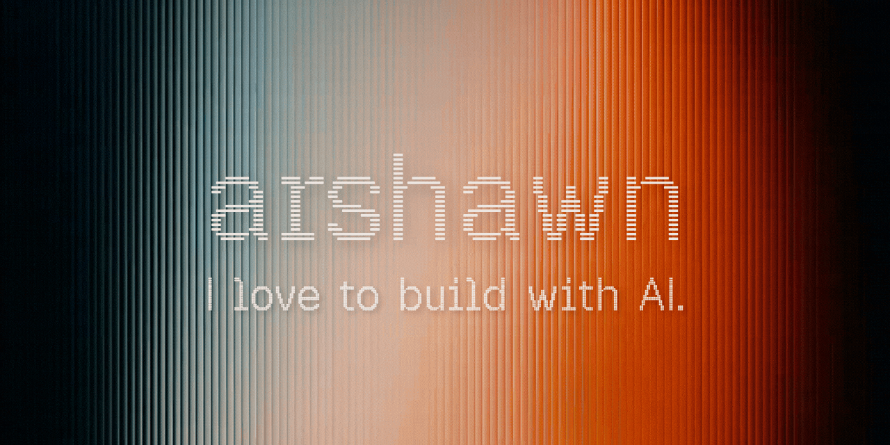

## Hi, I'm Arshawn

I'm a Computer Engineering student at UC Santa Cruz, and I'm looking for internships and freelance work.

I build most of my software by directing AI coding agents. I decide what a project should do and how it should look, then I review and test what the agents write.

---

### Now

**[Education Hub](https://github.com/arshawnarbabi/education-hub)** (April 2026 to now)  
The AI system I built to manage my entire school life. Agents read my Canvas, email, class recordings, notes and homework, then file every deadline and send a brief to my phone each morning. It tutors me under rules from a learning science review I had agents compile and fact-check, schedules my reviews with FSRS and checks each tutoring reply before I see it. It's an evolution of [Cogni](https://github.com/arshawnarbabi/Cogni), the open-source AI study app I built first, which I replaced after auditing it against how I actually studied. The linked repo is a cut-down public version with a demo you can run.

**[premium.md](https://github.com/arshawnarbabi/premium.md)** (May 2026 to now)  
Markdown templates that give an AI coding agent the brand, design, content, SEO and QA decisions it needs to build a polished product, plus an OKLCH palette generator.

**Client websites** (2026 to now)  
I design and build websites for clients, including [boltnav.com](https://boltnav.com) for the maker of an FDA-cleared spine surgery navigation device. My design work is at [arshawnarbabi.com](https://arshawnarbabi.com).

**Research reading class at UCSC** (fall 2026)  
I'm reading and presenting papers on brain-inspired neural networks, and working through Python notebooks on them.

---

[arshawnaa@gmail.com](mailto:arshawnaa@gmail.com) &nbsp;·&nbsp; [LinkedIn](https://www.linkedin.com/in/arshawnarbabi/) &nbsp;·&nbsp; [arshawnarbabi.com](https://arshawnarbabi.com)
